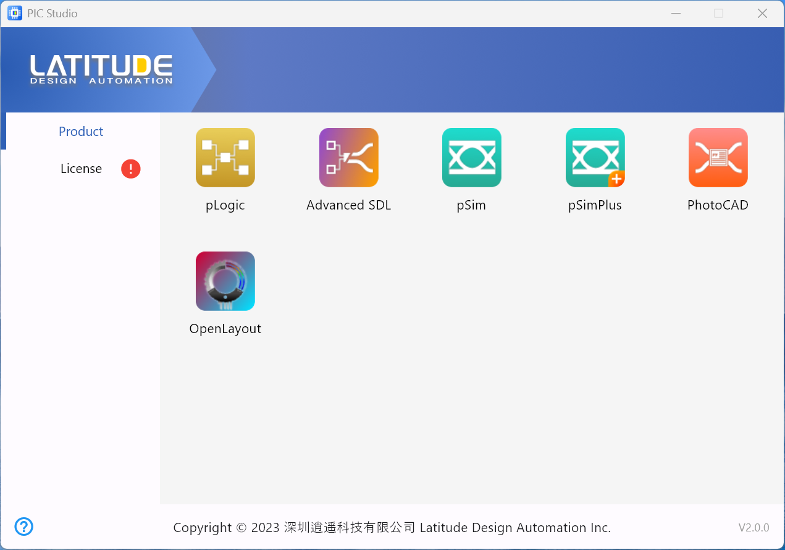
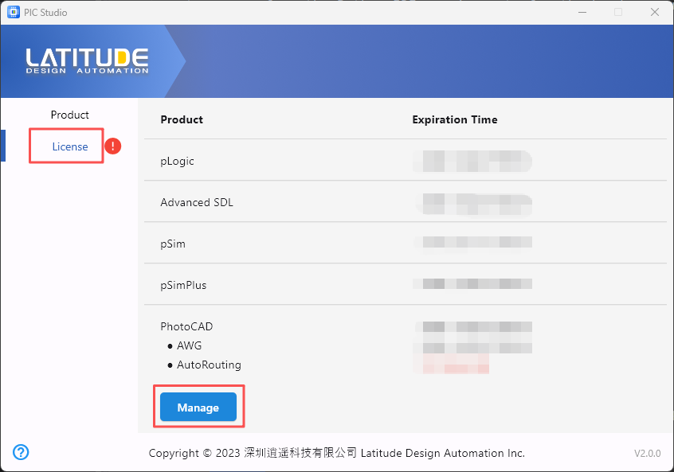
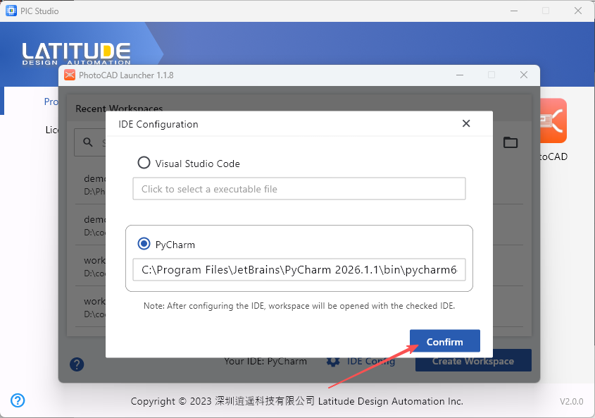
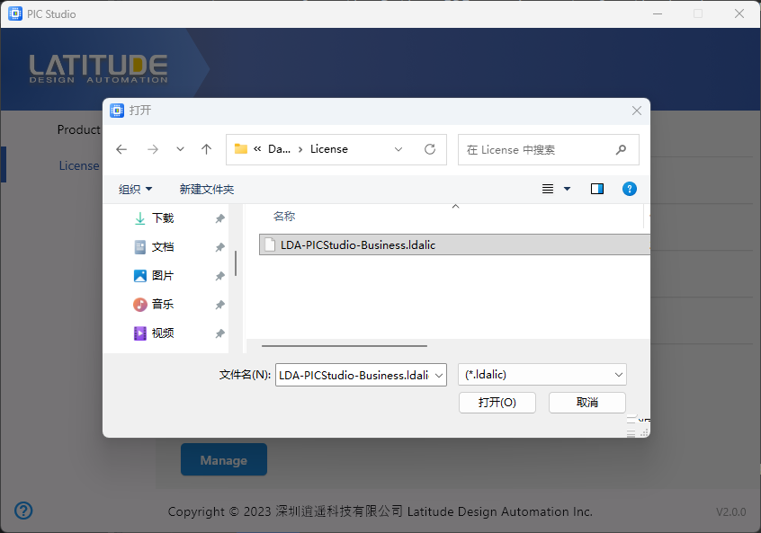
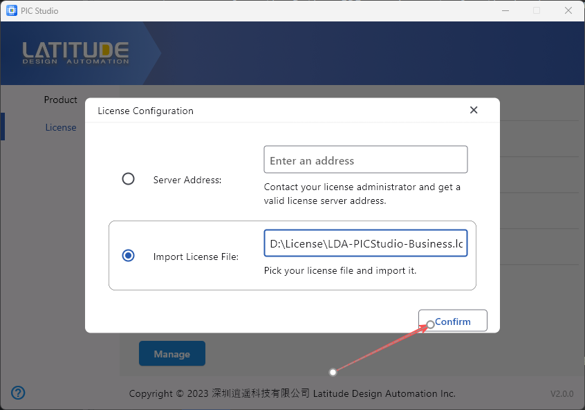
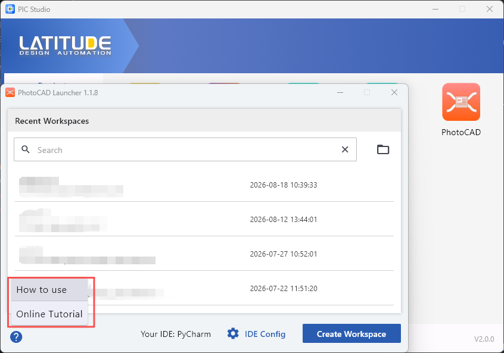

Installing PhotoCAD
^^^^^^^^^^^^^^^^^^^^^^^^^^^^^^^^^^^^^^^^^^^^

System Requirement
--------------------------------------------

**PhotoCAD** is written in the Python language and needs to be used in the Python IDE.Therefore, the requirements for the hardware and software systems are consistent with those of the Python IDE. The following configuration list is for reference only.

+----------------+---------------------+---------------------+
|                |Minimum              | Recommend           |
+================+=====================+=====================+
|RAM             |4GB RAM              | 16GB RAM            |
+----------------+---------------------+---------------------+
|CPU             |Main Stream CPU      | Multi-core CPU      |
+----------------+---------------------+---------------------+
| SSD            | 3GB                 |    5GB              |
+----------------+---------------------+---------------------+
|Display         | 1024x768            | 1920x1080           |
+----------------+---------------------+---------------------+
|Operating System| Windows 10/         | Latest 64-bit OS:   |
|                | macOS 10.13/        | Windows/            |
|                | Linux with Gnome/KDE| macOS/              |
|                |                     | Linux with Gnome/KDE|
+----------------+---------------------+---------------------+

**PhotoCAD** is written in Python3 and requires a 64-bit operating system. It is recommended to use Python 3.10 or higher as the interpreter.

Import license
-----------------------------------------------------

After opening PIC Studio, there are two tabs in the main interface: ``Product`` and ``License``.

Click on the ``Product`` tab, the interface shows the shortcut icons of the installed software products, you can launch the corresponding software products by clicking on the icons (you need to complete the License related configuration before launching the software).

Click on the ``License`` tab and the interface displays the installed software products and their associated license information.

To activate the software, click the **Manage** button to configure the ``License``.

Select **Import License File**, and then click the text box next to it.

Select the license file and click **Open**.

Click the **Confirm** button to activate all software products.

Install Python IDE
-----------------------------------------------------

It is recommended that users use PyCharm as the IDE for **PhotoCAD**, which is available in the free Community Edition of PyCharm. This manual example and software interface is based on PyCharm 2026.1.1 (Communication Edition) for Windows 11, which can be downloaded from its official website: https://www.jetbrains.com/pycharm

Notes
-------------------------------

Disable Antivirus Software During Installation
~~~~~~~~~~~~~~~~~~~~~~~~~~~~~~~~~~~~~~~~~~~~~~~~~~~~

During installation, antivirus software may incorrectly identify or block some installation files or executable programs. It is therefore recommended to temporarily disable antivirus software during the installation process and enable it again after the installation is completed.

License Error Troubleshooting
~~~~~~~~~~~~~~~~~~~~~~~~~~~~~~~~~~~

If a license error occurs when starting **PhotoCAD**, check the following items:

#. Confirm that the license file is located in the expected directory.

#. Confirm that the license has not expired and that it matches the current software environment.

#. Some license or environment changes may take effect only after **PhotoCAD** is restarted.

**PhotoCAD**-related documentation
~~~~~~~~~~~~~~~~~~~~~~~~~~~~~~~~~~~

For instructions and online manuals for **PhotoCAD** software products, please click on the **PhotoCAD** shortcut icon to open the **PhotoCAD** Launcher and click on **?** in the bottom left corner of the screen.

