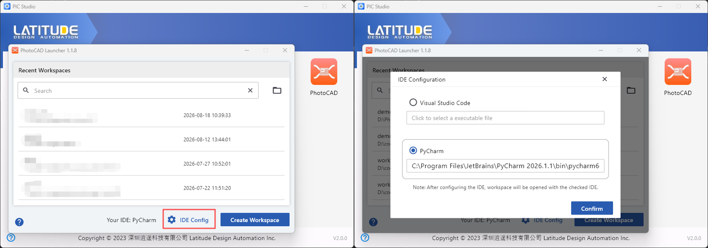
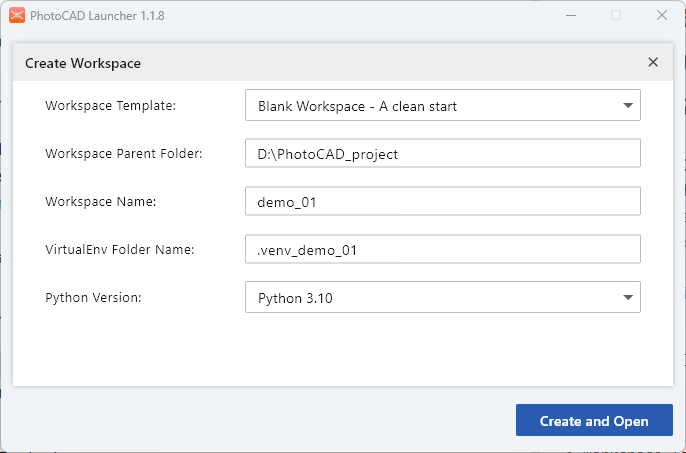
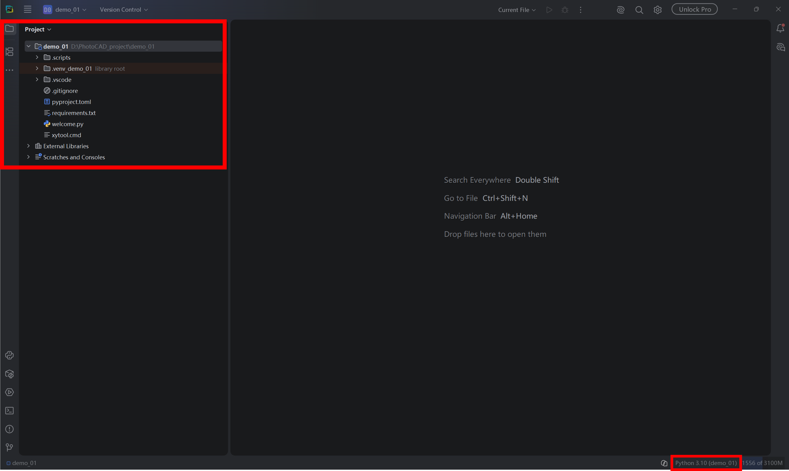
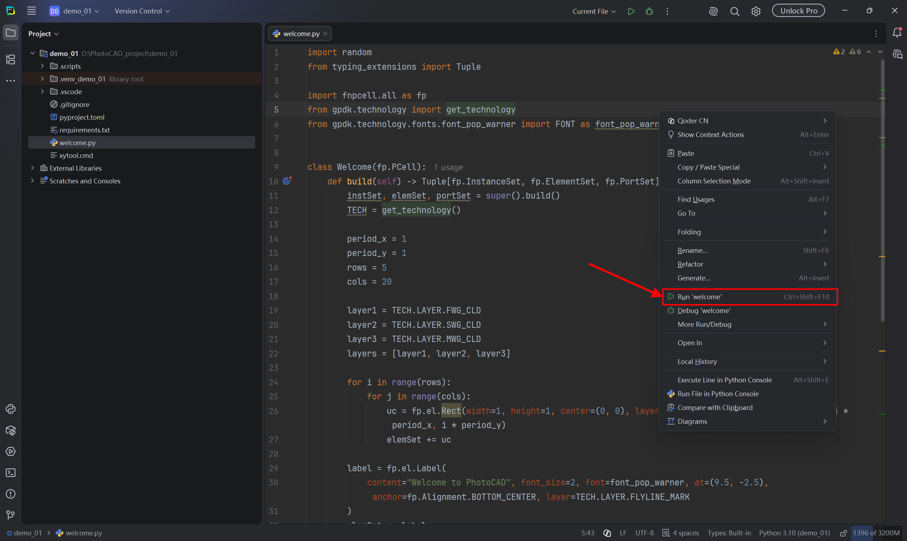
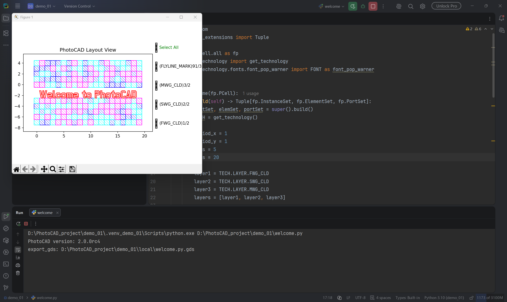

Quick Start
^^^^^^^^^^^^^^^^^^^^^^^^^^^^^^^^^^^^^^^^^^^^

This section provides a quick introduction to the basic **PhotoCAD** workflow. After completing the **PhotoCAD** installation and license configuration, users can create a project through the **PhotoCAD** Launcher, open the project in the configured Python IDE, and run the example welcome.py script.

Configure the IDE
--------------------------------------------

Open the **PhotoCAD** Launcher. The Launcher displays recently used workspaces and provides two main functions for configuring the development environment and creating a new workspace.

Click IDE Config at the bottom of the Launcher to open the IDE Configuration window.

**PhotoCAD** Launcher supports **Visual Studio Code** and **PyCharm** as the IDE. Select the desired IDE and specify its executable file. For example, when using PyCharm, select PyCharm and enter the path to the PyCharm executable.

Click Confirm to save the IDE configuration. After the IDE is configured, the workspace will be opened using the selected IDE.

Create a PhotoCAD Workspace
--------------------------------------------

After the IDE is configured, click ``Create Workspace`` to configure the workspace in the pop-up window.

* ``Workspace Template``

    * There are two options to choose from. ``Blank Workspace`` generates a cleaner package and ``Playground Workspace`` adds an extra example folder based on the first option.

* ``Workspace Parent Folder``

    * Select the workspace path.

* ``Workspace Name``

    * Define the name of the workspace.

* ``VirtualEnv Folder Name``

    * Specify the name of the virtual environment. We recommend that users do not change this setting. Use the default name or leave the .venv_ prefix and change only the suffix name.

* ``Python Version``

    * Select the Python version. We recommend that users select Python 3.10.

After the configuration, click ``Create and Open`` and the workspace will be automatically opened in the selected IDE. Based on the configuration in the figure above, a workspace named demo will be created and opened by PyCharm. On the left side you can see the workspace structure. Please make sure that the interpreter is the same as the configuration.

Double-click the ``welcome.py`` in demo the folder. Run this code by right-clicking on the code interface and selecting ``Run 'welcome'``.

The workspace has been created successfully if you see a pop-up window like the one shown below.

Start with ``gpdk``
----------------------------------------------------

For users who are new to **PhotoCAD PDK** development, it is recommended to start by learning the ``gpdk`` package. The ``gpdk`` package provides basic photonic components, routing functions, technology definitions, examples, and utility functions used in **PhotoCAD**.

Users can first study the examples and component implementations in gpdk to understand how PCells are defined, instantiated, connected, and exported as layouts.

For detailed information about ``gpdk``, please refer to :ref:`gpdk<gpdk>`.

