Common used transformation
^^^^^^^^^^^^^^^^^^^^^^^^^^^^^^^^^^

Transformation functions are useful when one needs to move or mirror the instance(PCells) to other places. These functions can be used for the PCells multiple times and combine them together.

1. translated_
2. scaled_
3. rotated_
4. mirrored_
5. place_

translated
---------------

* Usage: insts.translated()
* parameters: `tx`, `ty`
* ``Straight().translated(10, 20)``: Translates the cell by 10 units along the x-axis and 20 units along the y-axis.
* ``Straight().translated((10, 20))``: Translates the cell by the offset ``(10, 20)``.
* The origin of the cell can be defined in the PCell

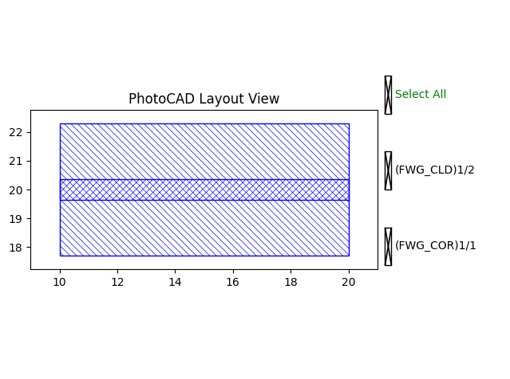

scaled
---------------

* Usage: insts.scaled()
* parameters: `sx`, `sy`, `origin`, `inplace`
* ``Straight().scaled(3)``: Scales the cell by a factor of 3 along both axes.

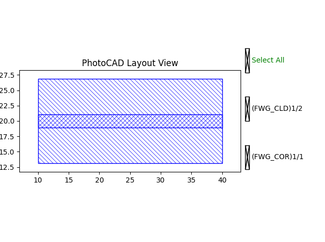

* ``Straight().scaled(3, 2)``: Scales the cell by a factor of 3 along the x-axis and 2 along the y-axis.

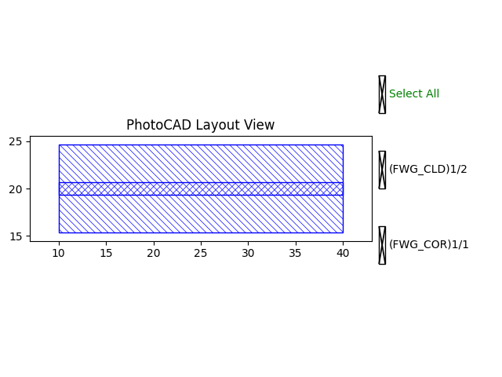

* ``origin`` specifies the scaling origin.

rotated
---------------

* Usage: insts.rotated()
* parameters: `degrees`, `radians`, `origin`, `inplace`
* ``Straight().rotated(degrees=90)``: Rotates the cell by 90 degrees around the origin.

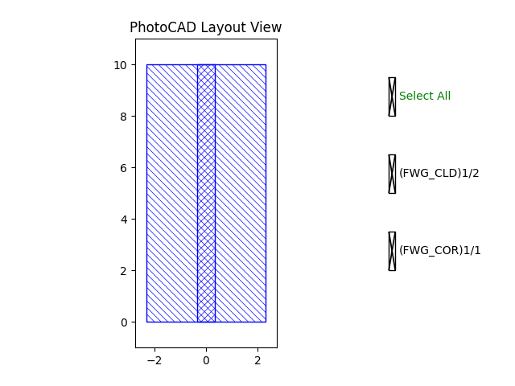

* ``Straight().rotated(radians=0.7854)``: Rotates the cell by approximately 45 degrees around the origin.

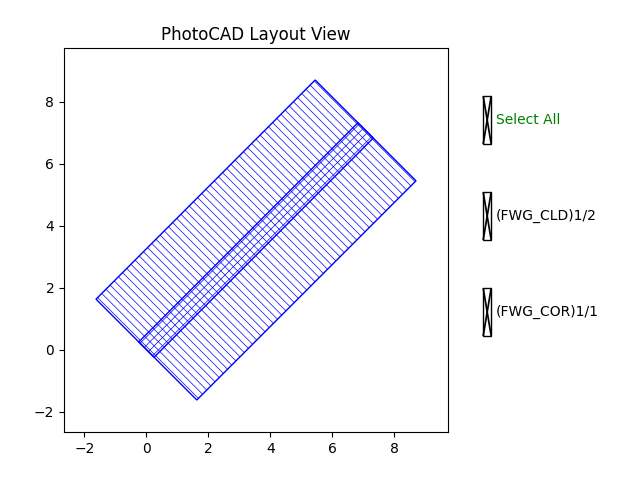

* Either ``degrees`` or ``radians`` must be provided. If both are specified, ``radians`` takes precedence.
* ``origin`` specifies the rotation center.

mirrored
---------------

* Usage: insts.*_mirrored()
* Parameters: ``x`` for ``h_mirrored()``, ``y`` for ``v_mirrored()``, ``origin`` or ``center`` for ``c_mirrored()``, and ``inplace`` for all three methods.
* ``Straight().h_mirrored()``: the cell with regard to the x-axis.
* ``Straight().v_mirrored()``: Mirrors the cell with regard to the y-axis.
* ``Straight().c_mirrored()``: Mirrors the cell with regard to the origin (0, 0).

place
---------------

This function positions a device by aligning its port with a specified coordinate or another device's port. It automatically translates and rotates the device when required, simplifying device placement and port-to-port connections. Let's say there are two devices(``device_A(bend)``, ``device_B(straight)``) and we wish to move the ``device_A`` to a specific place where related to the position of ``device_B``.

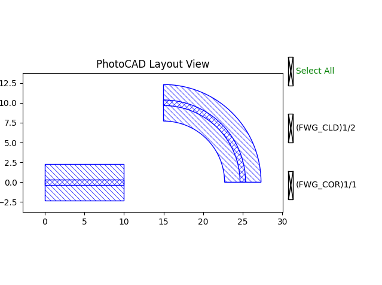

* **Placement at coordinates:** When ``at`` is a coordinate tuple or ``Point2D``, the specified port is translated to the target position.

.. code-block:: python

    new_device_A = fp.place(device_A, "port_A", at=(20, 0))
    # This places port ``port_A`` at coordinate ``(x, y)`` while preserving the device orientation.

* **Port alignment:** When ``at`` is another device's port, aligns the specified port with another device's port.

.. code-block:: python

    new_device_A = fp.place(device_A, "port_A", at=device_B["port_B"])
    # This connects port ``port_A`` and port ``port_B``.

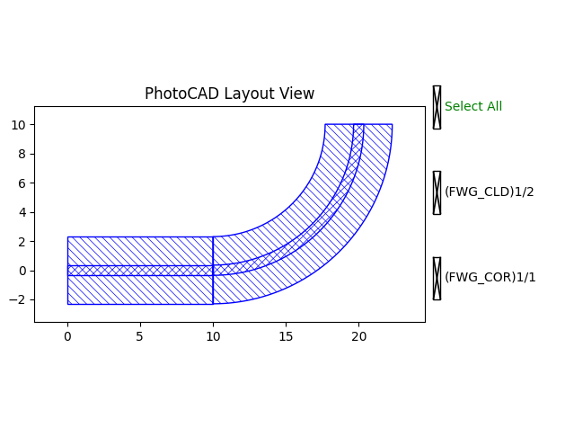

* **Placement by origin:** When ``alignment`` is omitted, the device origin is placed at the specified coordinates.

.. code-block:: python

    new_device_A = fp.place(device_A, at=(20, 0))
    # This places the origin of device_A at coordinate (x, y).

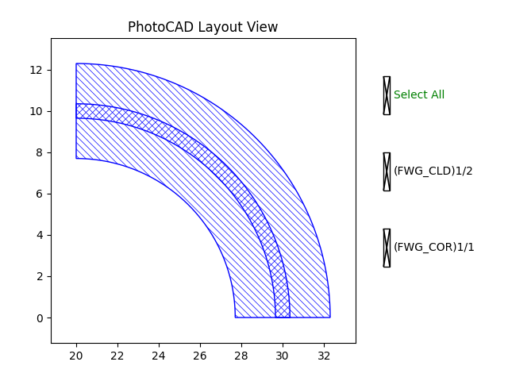

* **Placement at port coordinates:** When ``at`` is the position of another device's port, the specified port is moved to the same coordinates while preserving the device orientation.

.. code-block:: python

    new_device_A = fp.place(device_A, "port_A", at=device_B["port_B"].position)
    # This places ``port_A`` at the position of ``port_B`` but remaining the port orientation.

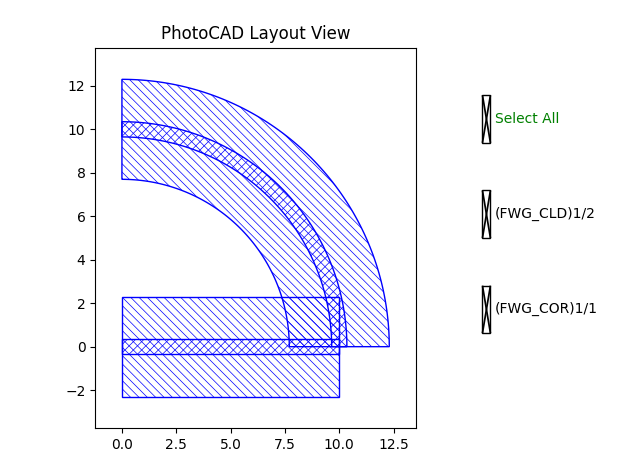

* **Placement with transformations:**

.. code-block:: python

    new_device_A = fp.place(device_A, "port_A", at=device_B["port_B"]).translated(20, 10)
    # ``port_A`` will first be aligned to ``port_B`` and move to ``(x, y)`` related to ``port_B``.

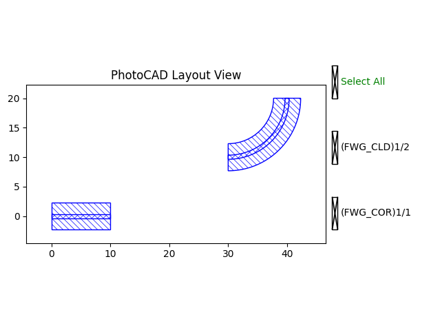

.. code-block:: python

    new_device_A = fp.place(device_A, "port_A", at=device_B["port_B"].rotated(degrees=-90))
    # ``port_A`` will be connected to  ``port_B`` with an angle difference of 90 degrees.

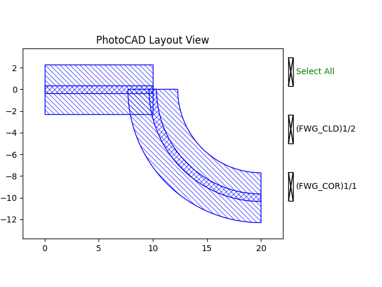

* **Placement using alignment:** The ``place()`` function supports nine alignment points through ``fp.Alignment``, allowing a device to be positioned by its corners, edges, or center without manually calculating offsets.

    The available alignment points are ``TOP_LEFT``, ``TOP_CENTER``, ``TOP_RIGHT``, ``MIDDLE_LEFT``, ``MIDDLE_CENTER``, ``MIDDLE_RIGHT``, ``BOTTOM_LEFT``, ``BOTTOM_CENTER``, and ``BOTTOM_RIGHT``.

.. code-block:: python

    mzi_array = MziArray()
    mzi_array1 = fp.place(mzi_array, fp.Alignment.TOP_LEFT, at=(0, 0))
    # Places the top left corner of the device at (0, 0).

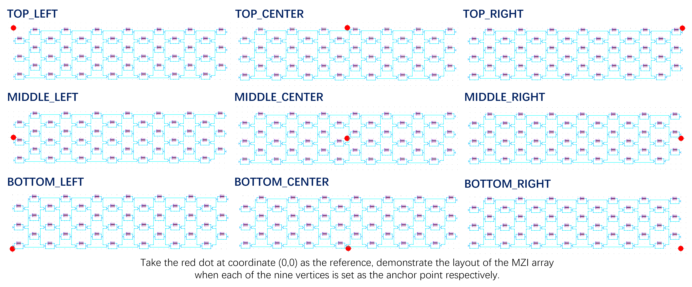