Waveguide Routing
=======================

Waveguide routing connects component ports by generating waveguides between them. The routing behavior can be configured through the straight waveguide type, bend factory, and path control. **PhotoCAD** provides four main options:

#. ``fp.LinkBetween``

#. ``fp.Linked``

#. ``fp.create_links``

#. ``TECH.LINKER``

These methods support different routing workflows, from creating a single connection to building a device with multiple connections. The following sections introduce their usage and key differences.

Single-port to Single-port
-------------------------------

There are three ways to define a connection between two ports:

1. ``fp.LinkBetween``
2. ``TECH.LINKER``
3. ``>>``

Here's a comparison of the three options:

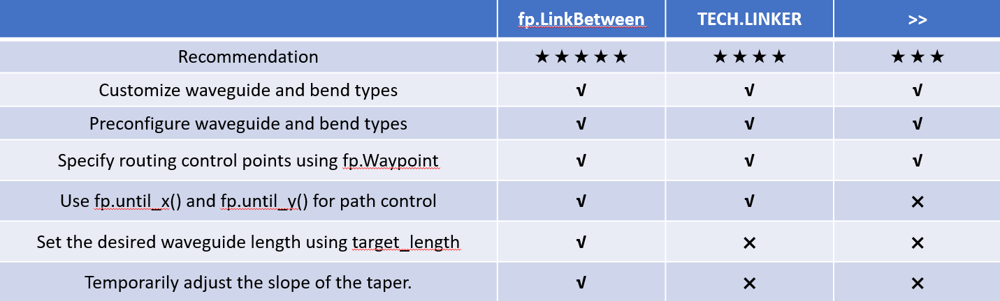

Among them, ``fp.LinkBetween`` allows the ``straight_type`` and ``bend_factory`` to be specified for an individual connection. ``LINKER`` uses a predefined routing configuration, so these parameters do not need to be specified again when using the linker. The ``>>`` operator defines the connection relationship and can include intermediate routing points.

Examples
~~~~~~~~~~~~~~~~~

.. code-block:: python

        # Call the device
        gcr = pdk.GratingCoupler()
        gcl = pdk.GratingCoupler().h_mirrored()

        # Place the device in different locations and add them to insts
        gcr1 = fp.place(gcr, "op_0", at=(100, -50))
        gcr2 = fp.place(gcr, "op_0", at=(100, 50))
        gcr3 = fp.place(gcr, "op_0", at=(100, 150))
        insts += gcr1, gcr2, gcr3
        gcl1 = fp.place(gcl, "op_0", at=(-100, -100))
        gcl2 = fp.place(gcl, "op_0", at=(-100, 0))
        gcl3 = fp.place(gcl, "op_0", at=(-100, 100))
        insts += gcl1, gcl2, gcl3
        # Use LinkBetween to define an individual connection with customized straight waveguide and bend types
        # Use path_control to define the path point
        link_1 = fp.LinkBetween(
            start=gcl1["op_0"],
            end=gcr1["op_0"],
            straight_type=TECH.WG.SWG.C.EXPANDED,
            bend_factory=TECH.WG.SWG.C.WIRE.BEND_CIRCULAR,
            path_control=[fp.Waypoint(-50, -50, 0)]
        )
        insts += link_1 # Add the generated connection to insts
        # Use LINKER to define the interconnection of the specified device port
        link_2 = TECH.LINKER.SWG_WIRE_FWG_EULER(
            start=gcl2["op_0"],
            end=gcr2["op_0"],
            path_control=[fp.Waypoint(0, 50, 0)]
        )
        insts += link_2
        # Define the connection relationship between device ports in specs
        link_3 = fp.create_links(
            specs=[gcl3["op_0"] >> fp.Waypoint(50, 150, 0) >> gcr3["op_0"]]
        )
        insts += link_3

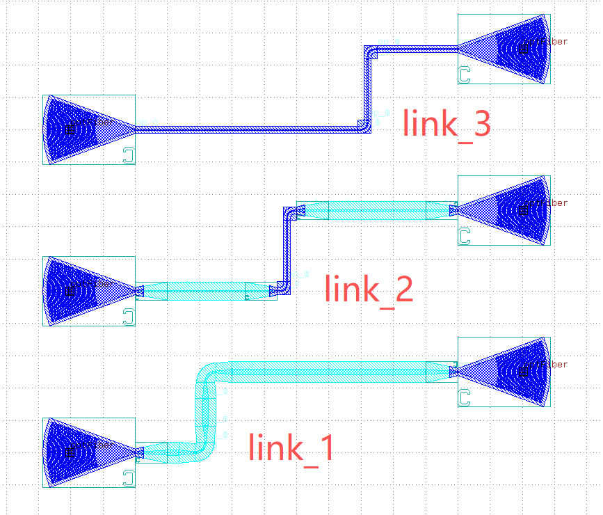

The ``auto_transition`` parameter of ``fp.LinkBetween`` allows customizing the automatic transition behavior for a single connection. If supported by the transition configuration, the taper slope can be temporarily adjusted without modifying the global PDK settings.

.. code-block:: python

    from gpdk.technology.auto_transition import WAVEGUIDE_ADAPTER

        insts += fp.LinkBetween(
            gcl1["op_0"], gcr1["op_0"],
            straight_type=TECH.WG.SWG.C.EXPANDED,
            bend_factory=TECH.WG.SWG.C.WIRE.BEND_CIRCULAR,
            auto_transition=TECH.AUTO_TRANSITION.STANDARD.updated(
                [(TECH.WG.SWG.C >> TECH.WG.SWG.C, WAVEGUIDE_ADAPTER.C.SLOPE_TAPER(slope=0.05))]),
        )

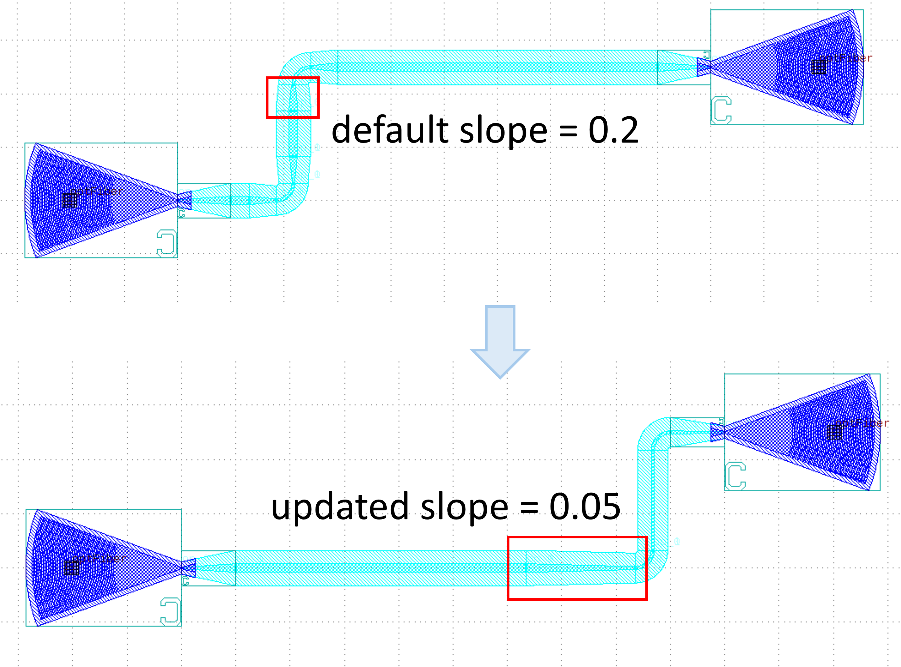

Multi-port to Multi-port
----------------------------

There are two types of connections from multi-port to multi-port:

1. ``fp.create_links``
2. ``fp.Linked``

Here's a comparison of the two options:

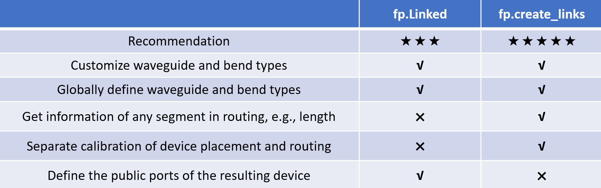

``fp.create_links`` example
~~~~~~~~~~~~~~~~~~~~~~~~~~~~~~~~~~~~~~~~

Use ``fp.create_links`` to generate multiple waveguide connections from the connection specifications provided in ``specs``. The ``waveguide_linker`` parameter defines the default routing configuration, including the straight waveguide type and bend factory.

.. code-block:: python

    # Interconnecting device ports by calling fp.create_links
    device = fp.create_links(
        # Define the waveguide type and bend factory for automatic routing
        waveguide_linker=fp.partial(
            fp.WaveguideBetween,
            straight_type=TECH.WG.FWG.C.WIRE,
            bend_factory=TECH.WG.FWG.C.WIRE.BEND_EULER,
        ),
        # Define the connection relationship between device ports in specs
        specs=[
            # Use >> to define connection relationships
            gcl1["op_0"] >> fp.Waypoint(-50, -50, 0) >> gcr1["op_0"],
            # Use LINKER to define the interconnection of the specified device port
            TECH.LINKER.SWG_WIRE_FWG_EULER(
                start=gcl2["op_0"],
                end=gcr2["op_0"],
                path_control=[fp.Waypoint(0, 50, 0)]
            ),
            # Use LinkBetween to define a separate segment of the connection,
            # and you can modify the type of the straight waveguide and bend with parameters
            fp.LinkBetween(
                start=gcl3["op_0"],
                end=gcr3["op_0"],
                straight_type=TECH.WG.SWG.C.EXPANDED,
                bend_factory=TECH.WG.SWG.C.WIRE.BEND_CIRCULAR,
                path_control=[fp.Waypoint(50, 150, 0)]
            ),
        ],
    )
    # Get and print the length of the three connected links
    length_1 = device[0].curve_length
    length_2 = device[1].curve_length
    length_3 = device[2].curve_length
    print(f"{length_1} \n {length_2} \n {length_3}")

    insts += device  # Add the devices returned by Linked to insts

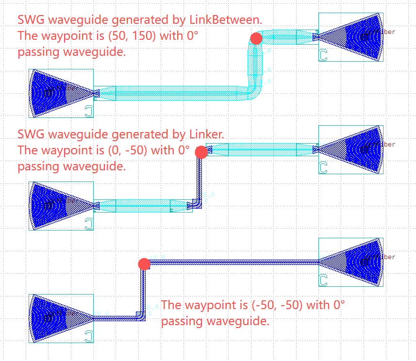

The message box shows that the lengths of each of the three connected links are printed.

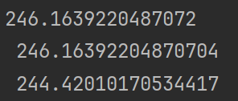

``fp.Linked`` example
~~~~~~~~~~~~~~~~~~~~~~~~~~~

Use ``fp.Linked`` to create a device that contains multiple waveguide connections. The ``links`` parameter specifies the connections, while ``ports`` defines the public ports exposed by the resulting device. The ``waveguide_linker`` parameter provides the default routing configuration for the connections.

.. code-block:: python

        # Interconnecting device ports by calling fp.Linked
        to = fp.Waypoint
        device = fp.Linked(
            # Define the waveguide type and bend factory for automatic routing
            waveguide_linker = fp.partial(
                fp.WaveguideBetween,
                straight_type=TECH.WG.FWG.C.EXPANDED,
                bend_factory=TECH.WG.FWG.C.WIRE.BEND_EULER,
            ),
            # Define the connection between device ports in links
            links=[
                gcl1["op_0"] >> fp.Waypoint(-50, -50, 0) >> gcr1["op_0"], # Use >> to define connections between two ports
                gcl2["op_0"] >> to(0, 50, 0) >> gcr2["op_0"],  # Use to or fp.Waypoint(x,y,a)" to define the path point
                # Use LinkBetween to define a separate segment of the connection,
                # and you can modify the type of the straight waveguide and bend with parameters
                fp.LinkBetween(
                    start=gcl3["op_0"],
                    end=gcr3["op_0"],
                    straight_type=TECH.WG.SWG.C.EXPANDED,
                    bend_factory=TECH.WG.SWG.C.WIRE.BEND_CIRCULAR,
                    path_control=[fp.Waypoint(50, 150, 0)]
                ),
            ],
            ports=[],  # No external ports are exposed by the linked device
        )

        insts += device # Add the linked device to the layout

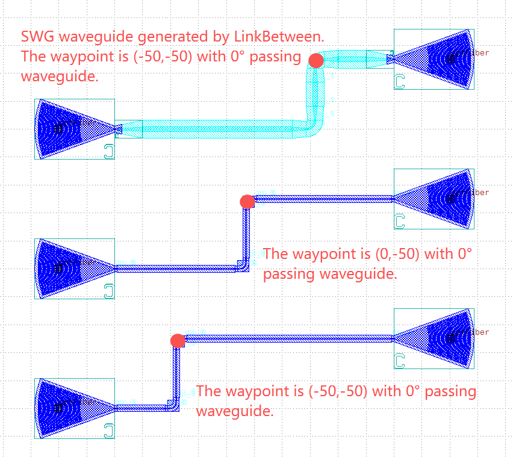

Path control
------------------------------

The ``path_control`` parameter controls the waveguide routing path. It supports absolute and relative control points, allowing the route to be constrained by specified coordinates or positions relative to the start point, end point, or previous control point.

Absolute control points provided
~~~~~~~~~~~~~~~~~~~~~~~~~~~~~~~~~~

Use ``fp.until_x()`` and ``fp.until_y()`` to constrain the route to pass through specified coordinate lines. The controls are applied in sequence. The example routes the waveguide through the vertical line ``x=-50``, the horizontal line ``y=50``, and the vertical line ``x=50``, in that order.

.. code-block:: python

    device = fp.LinkBetween(
        start=gcl1["op_0"],
        end=gcr1["op_0"],
        straight_type=TECH.WG.SWG.C.EXPANDED,
        bend_factory=TECH.WG.SWG.C.WIRE.BEND_CIRCULAR,
        # By setting waylines so that the waveguide passes through the x=-50, y=50 and x=50 lines in turn
        path_control=[fp.until_x(-50), fp.until_y(50), fp.until_x(50)]
    )

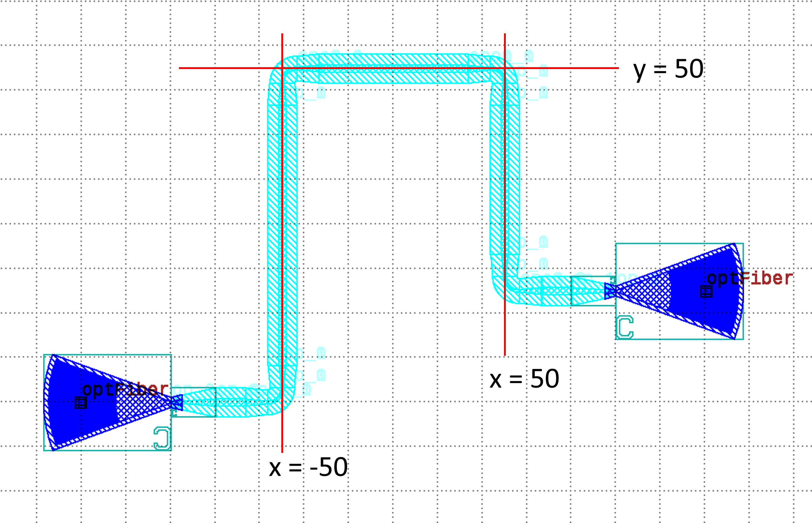

Alternatively, use ``fp.Waypoint(x, y, angle)`` to guide the waveguide through the control points, where x and y specify the coordinates and angle specifies the waveguide direction in degrees at each point. The example routes the waveguide through the points (-50, 10), (0, 50), and (50, 10), respectively.

.. code-block:: python

    device = fp.LinkBetween(
        start=gcl1["op_0"],
        end=gcr1["op_0"],
        straight_type=TECH.WG.SWG.C.WIRE,
        bend_factory=TECH.WG.FWG.C.WIRE.BEND_CIRCULAR,
        # Set waypoints to guide the waveguide through the path points, the three values in the fp.Waypoints brackets represent x,y,angle respectively.
        path_control=[
            fp.Waypoint(-50, 10, 90),
            fp.Waypoint(0, 50, 0),
            fp.Waypoint(50, 10, -90)
        ]
    )

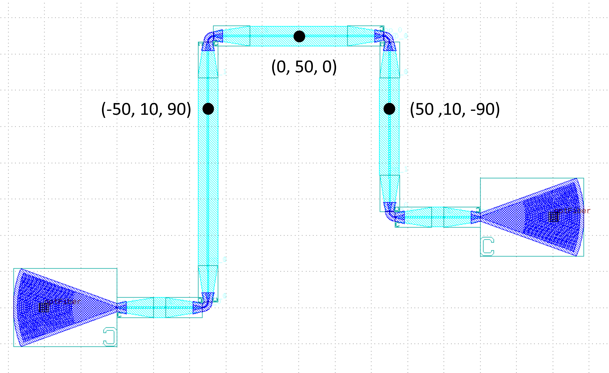

Relative control points provided
~~~~~~~~~~~~~~~~~~~~~~~~~~~~~~~~~~

Routing controls can also be defined relative to the starting port, ending port, or previous turning point.  ``fp.END`` is used to get the position of the ending port, and similarly ``fp.START`` can be used to get the position of the starting port. ``fp.PREV`` is used to get the position of the previous turning point, which allows the user to design based on the previous turning point.

.. code-block:: python

    device = fp.LinkBetween(
        start=gcl1["op_0"],
        end=gcr1["op_0"],
        straight_type=TECH.WG.SWG.C.WIRE,
        bend_factory=TECH.WG.FWG.C.WIRE.BEND_CIRCULAR,
        path_control=[
            fp.until_x(x=-80),  # Pass through the line x = -80
            fp.until_y(y=fp.START+150),  # Take the vertical coordinate Y of the starting port, where Y=0, and pass through the line y=Y+150
            fp.until_x(x=fp.PREV+50),  # Take the horizontal coordinate X of the last turn, here X = -80, and pass through the line x = X + 50
            fp.until_y(y=fp.END+50),  # Take the vertical coordinate Y of the termination port, where Y=-50, and pass through the line y=Y+50
            fp.until_x(x=fp.PREV+50)  # Take the horizontal coordinate X of the last turn, where X=-30, and pass through the line x=X+50
        ]
    )

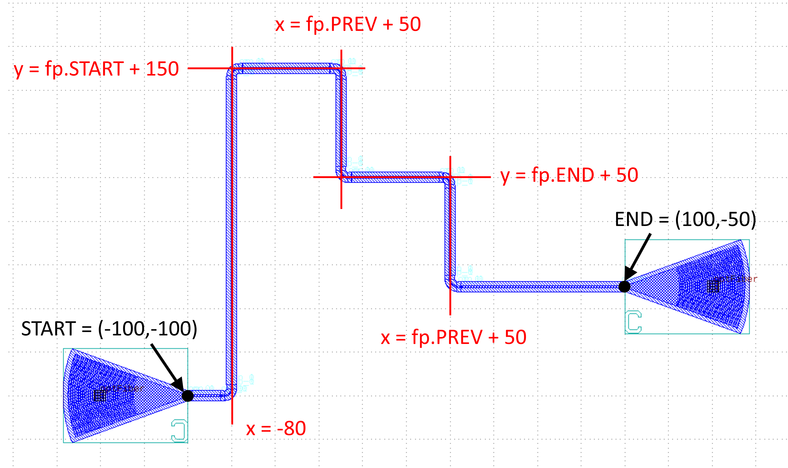

This allows the routing path to be defined relative to the port positions and previously specified turning points, rather than relying entirely on fixed absolute coordinates.

``target_length``
~~~~~~~~~~~~~~~~~~~~~~~~~~~~~~~~~~

The ``target_length`` parameter of ``fp.LinkBetween`` specifies the desired total waveguide length. The achievable length depends on the port positions, routing constraints, and waveguide geometry.

.. code-block:: python

    device = fp.LinkBetween(
        start=gcl1["op_0"],
        end=gcr1["op_0"],
        straight_type=TECH.WG.SWG.C.EXPANDED,
        bend_factory=TECH.WG.SWG.C.WIRE.BEND_CIRCULAR,
        # set target_length
        target_length=500
    )

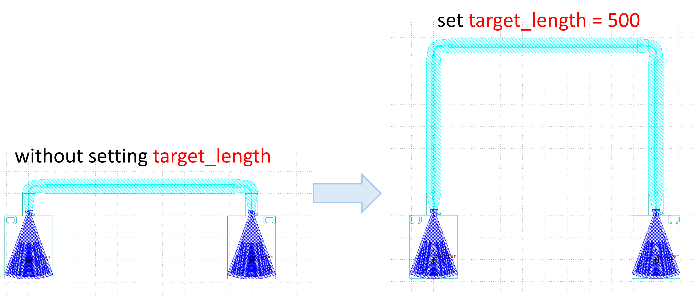
